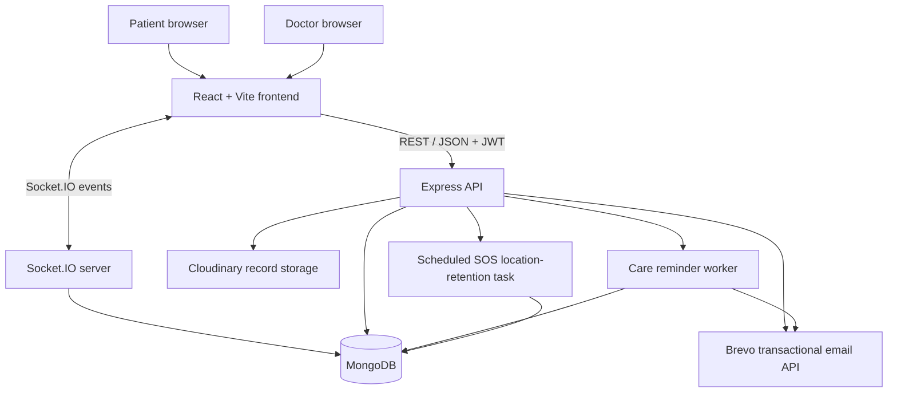

# NeuroNest

**A full-stack cognitive-care platform connecting patients and doctors.**

NeuroNest brings day-to-day cognitive care into one application: patient and doctor portals, care plans, cognitive exercises, medical records, appointments, real-time messaging, reminders, and emergency support.

> **Project status:** This repository contains a working full-stack application. External services such as MongoDB, Brevo, and Cloudinary must be configured for the corresponding features to operate. This software is a care-coordination tool; it is not a diagnostic system or a substitute for professional medical care.

---

## Contents

- [Overview](#overview)
- [Core capabilities](#core-capabilities)
- [Application architecture](#application-architecture)
- [Technology stack](#technology-stack)
- [Repository structure](#repository-structure)
- [Getting started](#getting-started)
- [Environment configuration](#environment-configuration)
- [How the application works](#how-the-application-works)
- [Security and privacy](#security-and-privacy)
- [Development workflow](#development-workflow)
- [Documentation](#documentation)

## Overview

NeuroNest has two role-specific experiences:

- **Patient portal:** helps a patient follow care activities, complete cognitive games, maintain personal and emergency information, manage appointments and records, and communicate with a linked doctor.
- **Doctor portal:** helps a doctor connect with patients, review relevant patient information and activity, manage care instructions, respond to alerts, coordinate appointments, and communicate with patients.

The frontend is a React single-page application. It communicates with an Express API over HTTP and uses Socket.IO for real-time chat. MongoDB stores application data through Mongoose models. Email delivery is handled by Brevo's transactional email API, and uploaded medical-record files are stored through Cloudinary.

## Core capabilities

| Area | Patient experience | Doctor experience |
| --- | --- | --- |
| Accounts | Register, verify email, sign in, reset password, manage account | Register, verify email, sign in, reset password, manage account |
| Patient–doctor connection | Request a doctor connection or share a connection code | Review/accept patient connections and link a patient by code |
| Care plan | View and mark medication/reminder items | Add medication and reminders; review care history and alerts |
| Cognitive games | Play available games and review personal history | Review connected patients' game activity |
| Medical records | Upload, list and download own records | List and download records for connected patients |
| Appointments | Request and cancel appointments | View requests, schedule or decline appointments |
| Messaging | Chat with a linked doctor | Chat with connected patients |
| Emergency support | Maintain emergency details and trigger SOS | Review SOS alerts and verify access to location details |

Feature access depends on authentication, role, account relationships, and the required external service configuration.

## Application architecture



### Main responsibilities

| Layer | Responsibility |
| --- | --- |
| `frontend/` | Browser UI, role-specific pages, navigation, client-side interactions and API calls |
| `backend/app.js` | Express middleware, CORS policy, health endpoint and API route mounting |
| `backend/server.js` | HTTP server, MongoDB startup, Socket.IO setup and background worker startup |
| `backend/routes/` | HTTP endpoint definitions and route-level authentication/role restrictions |
| `backend/controllers/` | Request validation, application operations and HTTP responses |
| `backend/models/` | Mongoose schemas and MongoDB persistence |
| `backend/services/` | Reusable care scheduling, history and retention logic |
| `backend/sockets/` | Authenticated real-time chat events |
| `backend/utils/` | Shared helpers such as email, JWT and schedule utilities |

## Technology stack

| Concern | Technologies |
| --- | --- |
| Frontend | React, Vite, React Router |
| Styling | Tailwind CSS, project CSS |
| Charts and icons | Recharts, Lucide React |
| Backend runtime | Node.js, Express |
| Database | MongoDB, Mongoose |
| Authentication | bcryptjs password hashing, JSON Web Tokens, email OTP |
| Real-time communication | Socket.IO and Socket.IO Client |
| Transactional email | Brevo REST API over HTTPS |
| File storage | Cloudinary |
| Upload handling | Multer |

## Repository structure

```text
NeuroNest/
├── backend/
│   ├── config/          # MongoDB, Cloudinary and upload configuration
│   ├── controllers/     # Request handlers and application logic
│   ├── middleware/      # JWT authentication, role checks and error handling
│   ├── models/          # Mongoose data models
│   ├── routes/          # REST API route definitions
│   ├── scripts/         # Maintenance and diagnostic scripts
│   ├── services/        # Care jobs, care history and SOS retention
│   ├── sockets/         # Socket.IO chat handlers
│   ├── utils/           # Email, JWT, OTP and scheduling helpers
│   ├── app.js           # Express application
│   ├── server.js        # HTTP and Socket.IO server entry point
│   ├── .env.example     # Backend environment template
│   └── package.json
├── frontend/
│   ├── public/          # Static public assets
│   ├── src/
│   │   ├── controllers/ # Frontend feature workflows
│   │   ├── models/      # API configuration, storage and app data
│   │   ├── routes/      # Client-side route composition
│   │   ├── services/    # HTTP and Socket.IO clients
│   │   └── views/       # Layouts, pages and reusable UI components
│   ├── .env.example     # Frontend environment template
│   └── package.json
└── README.md
```

## Getting started

### Prerequisites

- Node.js **20.19 or newer** (use a current supported Node.js LTS release).
- npm.
- A MongoDB database (local MongoDB or MongoDB Atlas).
- A Brevo account, API key and verified sender address for email-dependent features.
- Cloudinary credentials for medical-record uploads.

### 1. Clone the repository

```bash
git clone <YOUR_REPOSITORY_URL>
cd NeuroNest
```

### 2. Configure and start the backend

```bash
cd backend
npm install
```

Copy `backend/.env.example` to `backend/.env`, then set the required values. At minimum, configure `MONGO_URI` and a strong `JWT_SECRET`. Configure Brevo and Cloudinary for the features that depend on them.

Start the backend:

```bash
npm run dev
```

The API defaults to `http://localhost:5001`.

Check that it is responding:

```text
http://localhost:5001/api/health
```

Expected response:

```json
{
  "message": "NeuroNest API is running smoothly!"
}
```

### 3. Configure and start the frontend

Open a second terminal from the repository root:

```bash
cd frontend
npm install
```

Copy `frontend/.env.example` to `frontend/.env` and set the backend URL:

```env
VITE_API_URL=http://localhost:5001
```

Start Vite:

```bash
npm run dev
```

Open the local URL printed by Vite (normally `http://localhost:5173`).

### 4. Use the application

Choose the Patient or Doctor experience, register an account, and complete email verification. A patient and doctor must establish a connection before relationship-restricted features such as patient-specific care management and messaging are available.

## Environment configuration

Do not commit real `.env` files. The example files contain placeholders; replace them locally or in your deployment provider's secret manager.

### Backend variables

| Variable | Required | Description |
| --- | --- | --- |
| `PORT` | No | HTTP and Socket.IO port; defaults to `5001`. |
| `MONGO_URI` | Yes | MongoDB connection string. |
| `JWT_SECRET` | Yes | Secret used to sign and verify authentication tokens. Use a long, random value. |
| `BREVO_API_KEY` | For email | Brevo API key used by the transactional email integration. |
| `EMAIL_FROM` | For email | Sender address verified in Brevo. |
| `EMAIL_SEND_TIMEOUT_MS` | No | Maximum time allowed for an email API request; defaults to `12000` ms. |
| `CLOUDINARY_CLOUD_NAME` | For record uploads | Cloudinary cloud name. |
| `CLOUDINARY_API_KEY` | For record uploads | Cloudinary API key. |
| `CLOUDINARY_API_SECRET` | For record uploads | Cloudinary API secret. |
| `APP_TIMEZONE` | No | Time zone used by daily care scheduling; defaults to `Asia/Kolkata`. |
| `FRONTEND_URL` | For deployed frontend | Comma-separated frontend origins allowed by the backend CORS configuration. |

### Frontend variables

| Variable | Required | Description |
| --- | --- | --- |
| `VITE_API_URL` | Production: yes | Base URL of the backend, without a trailing slash. In local Vite development it defaults to `http://localhost:5001`. |

Vite variables prefixed with `VITE_` are included in the browser bundle. **Never put API secrets, database credentials, private keys or other server-side secrets in frontend environment variables.**

## How the application works

### Account and authentication flow

1. The user selects a role and submits registration details.
2. The backend validates the request, hashes the password and creates an account with the selected role.
3. The backend sends an email verification code through Brevo.
4. The user submits the code; the backend validates it and marks the account as verified.
5. On successful login, the backend issues a JWT. The frontend uses the token for protected API requests.
6. Backend middleware verifies the token and, where required, checks the user's role before allowing access.

### Patient and doctor connection

Patients and doctors are represented by user accounts with explicit roles. The patient can request a connection, and the doctor can accept a request or link a patient using the available connection-code workflow. Patient-specific doctor operations are restricted by the authenticated account and relationship checks in the backend.

### Care plans and reminders

Doctors can add medication and reminder instructions for connected patients. Patients can review care items and update their completion status. The backend's care worker processes scheduled checks, sends applicable reminders, and creates doctor-facing care alerts. Care history records daily outcomes such as completed or missed items.

### Cognitive games and history

The frontend provides the cognitive-game selection and game experiences. Completed sessions are submitted to the games API. The backend stores session metadata such as game type, level reached, mistakes, accuracy and play time. Patients can review their own history, while authorized doctors can review activity for connected patients.

### Medical records

A patient uploads a file through the records API. Multer handles the incoming upload, Cloudinary stores the file, and MongoDB stores record metadata and the Cloudinary identifiers. Access is restricted by role and patient relationship. The API provides authorized record listing and download operations.

### Appointments and messaging

Patients create appointment requests. Doctors can view requests and schedule or decline them; patients can cancel their requests. Messaging uses a conversation record in MongoDB and Socket.IO events for real-time delivery. The backend verifies conversation participation before allowing a user to join or send messages.

### SOS and location privacy

A patient can trigger an SOS event with location information when available. The doctor receives a one-time verification code by email. The SOS workflow requires the doctor to verify the code before the location is revealed through the intended notification flow. Successful location access is recorded, and stored coordinates are redacted by the retention service after the configured retention period (currently seven days).

## Security and privacy

- Passwords are hashed before storage.
- Protected HTTP routes require a JWT; role-specific routes enforce patient or doctor access.
- Chat events require an authenticated socket connection and authorized conversation membership.
- Medical-record routes enforce patient/doctor access checks.
- Brevo and Cloudinary credentials belong only in backend environment variables.
- SOS location access uses a doctor OTP and access auditing; stored coordinates are subject to retention cleanup.
- Use HTTPS in production and configure `FRONTEND_URL` with only trusted frontend origins.
- Do not use real patient information in development screenshots, test fixtures or public issue reports.

**Operational note:** Configure and test email delivery, database access, file uploads, CORS and deployment secrets before relying on these workflows in a live environment.

## Development workflow

Run frontend and backend in separate terminals. Typical commands:

| Directory | Command | Purpose |
| --- | --- | --- |
| `backend/` | `npm run dev` | Start backend with Nodemon. |
| `backend/` | `npm start` | Start backend with Node.js. |
| `backend/` | `npm run email:test` | Test configured Brevo email delivery (see backend guide). |
| `backend/` | `npm run migrate:accounts` | Run the account-index migration script. |
| `frontend/` | `npm run dev` | Start Vite development server. |
| `frontend/` | `npm run build` | Build the production frontend into `dist/`. |
| `frontend/` | `npm run preview` | Preview the production build locally. |
| `frontend/` | `npm run lint` | Run ESLint. |

## Documentation

- [Frontend guide](frontend/README.md) — frontend structure, portals, routing, state and API communication.
- [Backend guide](backend/README.md) — API, middleware, models, services, background processing and integrations.

## Contributing

1. Create a focused branch for your change.
2. Keep frontend presentation, backend business logic and persistence responsibilities in their respective layers.
3. Validate the affected flows locally.
4. Run the frontend lint/build checks and relevant backend checks.
5. Never commit `.env` files, API keys, database URLs, personal data or generated dependency folders.

## License

No license is currently specified in this repository. Contact the project owner before redistributing or reusing the code.
