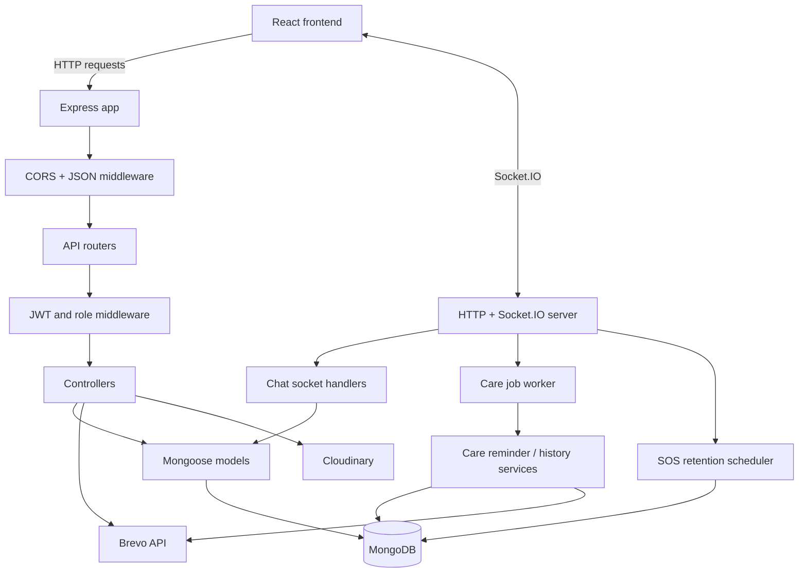
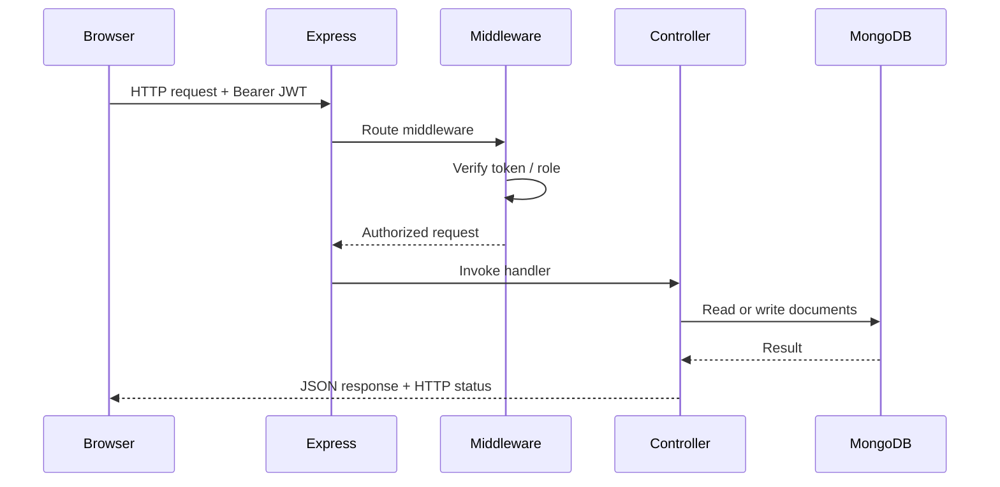

# NeuroNest Backend

The NeuroNest backend is a Node.js and Express service that exposes the application's REST API, persists application data in MongoDB, hosts authenticated Socket.IO chat, and runs scheduled care and SOS-retention processes.

## Contents

- [Responsibilities](#responsibilities)
- [Technology](#technology)
- [Architecture](#architecture)
- [Project structure](#project-structure)
- [Request lifecycle](#request-lifecycle)
- [Authentication and authorization](#authentication-and-authorization)
- [API reference](#api-reference)
- [Data model overview](#data-model-overview)
- [Background processing](#background-processing)
- [Real-time chat](#real-time-chat)
- [External integrations](#external-integrations)
- [Local development](#local-development)
- [Environment variables](#environment-variables)
- [Scripts](#scripts)
- [Security and operations](#security-and-operations)

## Responsibilities

The backend is the trusted application layer. It is responsible for:

- Authentication, email verification, password reset and account operations.
- Enforcing patient/doctor role restrictions and relationship-based access.
- Managing patient–doctor connections and care information.
- Recording cognitive-game sessions and serving history.
- Managing appointments and medical records.
- Providing real-time chat authorization and message persistence.
- Sending transactional email through Brevo.
- Running care reminder checks and SOS location-retention cleanup.

## Technology

| Technology | Purpose |
| --- | --- |
| Node.js (ES modules) | Server runtime |
| Express 5 | HTTP API and middleware |
| MongoDB + Mongoose | Database and schema/model layer |
| JSON Web Token | Signed authentication tokens |
| bcryptjs | Password hashing |
| Socket.IO | Real-time chat transport |
| Multer | Multipart file upload handling |
| Cloudinary | Medical-record file storage |
| Brevo API | Transactional email delivery |
| dotenv | Environment configuration |

## Architecture



### Server startup

`server.js` is the process entry point. It:

1. Loads environment configuration.
2. Creates the HTTP server around the Express application.
3. Configures Socket.IO CORS origins and registers chat handlers.
4. Connects to MongoDB.
5. Checks Brevo API configuration/reachability asynchronously so an email-provider problem is logged without blocking API startup.
6. Starts the care job worker and SOS location-retention scheduler.
7. Starts listening on `PORT` (default `5001`).

The MongoDB connection is required for successful startup. Email and Cloudinary are required for their respective features, not for every API operation.

## Project structure

```text
backend/
├── config/
│   ├── db.js              # MongoDB connection
│   ├── cloudinary.js      # Cloudinary client configuration
│   └── multer.js          # Temporary upload handling and limits
├── controllers/           # HTTP request handlers and business operations
├── middleware/
│   ├── auth.js            # JWT verification and role authorization
│   └── errorHandler.js    # Centralized Express error handling
├── models/                # Mongoose schemas and models
├── routes/                # REST endpoint declarations
├── scripts/               # Email test and account-index migration scripts
├── services/
│   ├── careJobQueue.js    # Persistent care-check job worker
│   ├── careReminderService.js
│   ├── careHistoryService.js
│   └── sosRetentionService.js
├── sockets/
│   └── chatSocket.js      # Authenticated chat events
├── utils/
│   ├── sendEmail.js       # Brevo transactional email integration
│   ├── jwt.js             # JWT helpers
│   └── ...                # OTP and care-schedule helpers
├── app.js                 # Express app, middleware and route mounting
├── server.js              # HTTP/Socket.IO server and startup orchestration
├── .env.example
└── package.json
```

### Layer responsibilities

- **Routes** define HTTP methods, URL patterns and middleware composition. They should remain thin.
- **Middleware** performs cross-cutting checks such as token verification and role restrictions.
- **Controllers** handle request-specific validation, call the relevant models/services and shape HTTP responses.
- **Models** define persisted document structures, references, defaults, enums and indexes.
- **Services** hold reusable workflows that may be called by controllers or background workers.
- **Sockets** handle authenticated real-time events and enforce conversation membership.
- **Utilities** provide reusable infrastructure functions such as email delivery, OTP/JWT handling and date/time calculations.

## Request lifecycle



1. `app.js` applies CORS and JSON parsing, exposes `/api/health`, mounts the routers and installs the error handler.
2. A route applies `verifyToken` and, where appropriate, `requireRole`.
3. The controller performs the operation using Mongoose models and service helpers.
4. The API returns a JSON response.
5. Errors are passed to the central error handler.

## Authentication and authorization

### JWT authentication

Protected endpoints expect:

```http
Authorization: Bearer <jwt>
```

`verifyToken` validates the token and makes the authenticated user available to downstream handlers. `requireRole("patient")` and `requireRole("doctor")` restrict routes to the corresponding account role.

### Relationship authorization

A valid JWT and role are not sufficient for every operation. Patient-specific doctor operations must also verify that the target patient is connected to the authenticated doctor. Record access, conversation access and other relationship-dependent operations must apply their corresponding ownership/participant checks.

### Account and verification flows

The authentication routes support registration, OTP verification, OTP resend, login, password reset, current-user lookup and account deletion. Passwords are hashed with bcryptjs. Email verification and password reset use time-limited codes delivered through Brevo.

## API reference

All REST endpoints are prefixed with `/api`. The table below summarizes the route groups and their principal operations. Route files are the source of truth for exact request bodies, response formats and validation behavior.

| Route group | Endpoint | Method | Access | Purpose |
| --- | --- | --- | --- |
| Health | `/api/health` | GET | Public | API health response |
| Auth | `/api/auth/register` | POST | Public | Register an account |
| Auth | `/api/auth/verify-otp` | POST | Public | Verify email code |
| Auth | `/api/auth/resend-otp` | POST | Public | Resend verification code |
| Auth | `/api/auth/login` | POST | Public | Sign in |
| Auth | `/api/auth/forgot-password` | POST | Public | Request password-reset code |
| Auth | `/api/auth/reset-password` | POST | Public | Reset password |
| Auth | `/api/auth/me` | GET | Authenticated | Get current account |
| Auth | `/api/auth/account` | DELETE | Authenticated | Delete current account |
| Patient | `/api/patient/*` | Various | Patient | Doctor connection, emergency details and care-item status |
| Doctor | `/api/doctor/*` | Various | Doctor | Patient roster, linking, care alerts/settings, medications, reminders, diagnoses and care history |
| Games | `/api/games/log` | POST | Authenticated | Save a game session |
| Games | `/api/games/history/:patientId` | GET | Authenticated | Read permitted game history |
| Appointments | `/api/appointments/*` | Various | Role-restricted | Request, list, schedule, decline or cancel appointments |
| Records | `/api/records/*` | Various | Role-restricted | Upload, list and download medical records |
| Chat | `/api/chat/conversation` | POST | Authenticated | Get or create a permitted conversation |
| Chat | `/api/chat/:conversationId/messages` | GET | Authenticated | Read conversation messages |
| SOS | `/api/sos/alert` | POST | Patient | Trigger SOS |
| SOS | `/api/sos/doctor/alerts` | GET | Doctor | List doctor SOS alerts |
| SOS | `/api/sos/doctor/verify` | POST | Doctor | Verify SOS doctor OTP |

### Route details by domain

- `routes/auth.js` — public account creation, verification, login and password-reset endpoints; authenticated account lookup and deletion.
- `routes/patient.js` — patient-only doctor lookup/request, emergency details and care-item completion.
- `routes/doctor.js` — doctor-only patient management, care alerts, notification preferences, medication/reminder and diagnosis operations.
- `routes/games.js` — game-session logging and history.
- `routes/appointments.js` — patient appointment requests/cancellation and doctor scheduling/decline.
- `routes/records.js` — patient upload/list, doctor patient-record listing and authorized download.
- `routes/chat.js` — conversation creation/retrieval and message history.
- `routes/sos.js` — patient SOS trigger and doctor alert/OTP verification.

Protected route access should always be checked against the implementation, not inferred from the frontend navigation.

## Data model overview

The main Mongoose models include:

| Model | Purpose |
| --- | --- |
| `User` | Patient and doctor accounts, role, verification state, profile data, care instructions and relationship fields |
| `GameSession` | Game type, patient, level, mistakes, accuracy and play timestamp |
| `Appointment` | Patient/doctor appointment request, status and scheduled date |
| `MedicalRecord` | Uploaded file metadata and Cloudinary identifiers |
| `Conversation` | Conversation participants and latest-message reference |
| `Message` | Conversation message, sender, text and read state |
| `CareHistory` | Dated medication/reminder history and completion status |
| `CareAlert` | Doctor-facing care alerts, including missed-game alerts |
| `Job` | Persistent queued care-check job state, attempts and lock metadata |
| `SOS` | Emergency event, doctor OTP hash, location access audit and retention metadata |

The `User` schema includes nested structures for medication items, diagnosis notes and emergency details. Refer to `models/` for complete schema definitions, indexes and defaults.

## Background processing

### Care job worker

`services/careJobQueue.js` runs a persistent job worker. It periodically enqueues and claims care-check jobs stored in MongoDB, applies a lock while a job is running, tracks attempts, and records completion or failure. The care reminder service evaluates patient schedules and performs the applicable reminder/alert operations.

The care scheduling logic includes:

- Daily game follow-up stages.
- Medication reminder checks.
- Doctor reminder checks.
- Doctor-facing alerts for missed care activities.
- Care-plan history maintenance and archival.

The configured time zone is `APP_TIMEZONE`, defaulting to `Asia/Kolkata`. Exact reminder windows and state transitions are implemented in `services/careReminderService.js` and `utils/careSchedule.js`.

### Care history

The care-history service maintains dated records for care items. Items are represented with statuses such as `pending`, `completed` and `missed`, allowing the application to display a history rather than relying only on the current active plan.

### SOS location retention

`services/sosRetentionService.js` periodically checks SOS records and clears stored latitude, longitude and accuracy after the configured expiry/retention condition. The current retention behavior redacts expired location data after seven days while preserving the SOS record and audit metadata.

## Real-time chat

Socket.IO is attached to the same HTTP server as Express.

The chat flow is:

1. The frontend connects using its signed-in session token.
2. The server authenticates the socket connection.
3. A client requests to join a conversation room.
4. The server checks that the user is a participant in that conversation.
5. Authorized messages are persisted and delivered to the room.

The REST chat routes support conversation lookup/creation and message history. Socket event names and payloads are defined in `sockets/chatSocket.js`; treat that file as the source of truth for the event contract.

## External integrations

### Brevo transactional email

`utils/sendEmail.js` sends email through Brevo's HTTPS API endpoint:

```text
POST https://api.brevo.com/v3/smtp/email
```

It uses `BREVO_API_KEY` for API authentication and `EMAIL_FROM` for the verified sender address. The integration supports account verification, password reset, appointment notifications, care reminders and SOS-related messages.

The backend performs a lightweight Brevo account/API-key check at startup. Email configuration errors are logged; they do not by themselves prevent the API from starting. Email-dependent operations will fail until the integration is correctly configured.

If Brevo reports an unauthorized source IP, review the Brevo account's authorized IP security settings. Do not disable account security blindly; authorize only trusted egress IP addresses or use an appropriate stable deployment egress configuration.

### Cloudinary

`config/cloudinary.js` configures the Cloudinary SDK. Medical-record uploads are accepted through Multer, temporarily stored under the backend upload temp directory, then uploaded to Cloudinary by the record workflow. MongoDB stores metadata and Cloudinary identifiers.

### MongoDB

`config/db.js` connects Mongoose to the database specified by `MONGO_URI`. The application cannot start its main server successfully without a working MongoDB connection.

## Local development

### Prerequisites

- Node.js 20.19 or newer.
- npm.
- A reachable MongoDB database.
- Brevo credentials and a verified sender for email-dependent flows.
- Cloudinary credentials for record upload flows.

### Install dependencies

From the repository root:

```bash
cd backend
npm install
```

### Configure environment

Copy `.env.example` to `.env` and populate the values described below. Never commit `.env`.

### Start the backend

```bash
npm run dev
```

The default API/Socket.IO port is `5001`.

For a non-watch process:

```bash
npm start
```

### Health check

Open:

```text
http://localhost:5001/api/health
```

Expected response:

```json
{
  "message": "NeuroNest API is running smoothly!"
}
```

## Environment variables

The canonical template is `backend/.env.example`.

| Variable | Required | Purpose |
| --- | --- | --- |
| `PORT` | No | Server port; defaults to `5001`. |
| `MONGO_URI` | Yes | MongoDB connection URI. |
| `JWT_SECRET` | Yes | Secret used to sign and verify JWTs. Use a long, unpredictable value. |
| `BREVO_API_KEY` | For email | Brevo API key. |
| `EMAIL_FROM` | For email | Sender email address verified in Brevo. |
| `EMAIL_SEND_TIMEOUT_MS` | No | Email request timeout in milliseconds; defaults to `12000`. |
| `CLOUDINARY_CLOUD_NAME` | For uploads | Cloudinary cloud name. |
| `CLOUDINARY_API_KEY` | For uploads | Cloudinary API key. |
| `CLOUDINARY_API_SECRET` | For uploads | Cloudinary API secret. |
| `APP_TIMEZONE` | No | Time zone used by care scheduling; defaults to `Asia/Kolkata`. |
| `FRONTEND_URL` | For deployment | Comma-separated allowed frontend origins for CORS. |

For local development, the backend allows `http://localhost:5173` and `http://localhost:5174` in its CORS configuration. Add the deployed frontend origin to `FRONTEND_URL`.

## Scripts

| Command | Description |
| --- | --- |
| `npm run dev` | Start `server.js` with Nodemon. |
| `npm start` | Start `server.js` with Node.js. |
| `npm run email:test` | Verify Brevo configuration and send a test email using the email test script. |
| `npm run migrate:accounts` | Run the account-index migration script. |

## Security and operations

- Keep `.env` out of version control. Rotate any credential that has been accidentally committed or shared.
- Use a strong, unique `JWT_SECRET`; do not reuse a public or example value.
- Use HTTPS for deployed API traffic.
- Configure CORS with trusted origins only.
- Do not trust role or patient identifiers supplied by the browser without validating them against the authenticated user and database relationships.
- Restrict access to uploaded medical records and avoid exposing raw storage credentials or unrestricted Cloudinary URLs.
- Keep OTPs short-lived, rate-limited and protected against repeated attempts as implemented by the authentication/SOS workflows.
- Avoid logging access tokens, OTPs, patient records or exact SOS coordinates.
- Test Brevo and Cloudinary integrations in a non-production environment before enabling dependent workflows.
- Review data retention, consent, incident response and applicable healthcare/privacy requirements before using real patient data in production.

## Troubleshooting

| Symptom | What to check |
| --- | --- |
| Backend exits during startup | Confirm `MONGO_URI`, database network access and MongoDB availability. |
| Frontend requests fail | Confirm backend is running and `VITE_API_URL` points to the correct API origin. |
| Browser reports CORS errors | Add the exact frontend origin to `FRONTEND_URL`; check scheme, hostname and port. |
| OTP or reminder email fails | Check `BREVO_API_KEY`, verified `EMAIL_FROM`, Brevo account status, API response and authorized-IP restrictions. |
| Record upload fails | Check Cloudinary credentials, file type/size and upload configuration. |
| Chat cannot connect | Check JWT validity, Socket.IO CORS origins, conversation membership and server logs. |
| A protected route returns 401/403 | Check token validity, selected role and patient–doctor relationship authorization. |

## Related documentation

- [Project overview and local setup](../README.md)
- [Frontend architecture and UI guide](../frontend/README.md)
