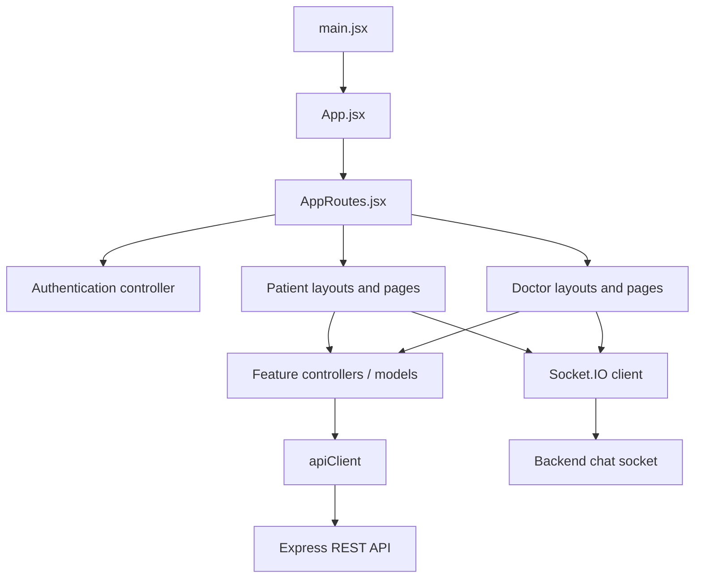

# NeuroNest Frontend

The NeuroNest frontend is a React single-page application built with Vite. It provides separate patient and doctor experiences over a shared authentication and navigation foundation.

## Contents

- [Responsibilities](#responsibilities)
- [User experiences](#user-experiences)
- [Technology](#technology)
- [Architecture and data flow](#architecture-and-data-flow)
- [Source structure](#source-structure)
- [Routing](#routing)
- [API and authentication](#api-and-authentication)
- [Real-time communication](#real-time-communication)
- [Local development](#local-development)
- [Environment variables](#environment-variables)
- [Scripts](#scripts)
- [Implementation notes](#implementation-notes)

## Responsibilities

The frontend is responsible for:

- Rendering the patient and doctor portals.
- Handling navigation and role-specific page composition.
- Collecting user input and presenting validation/API feedback.
- Calling the backend REST API.
- Maintaining the browser-side authenticated session.
- Establishing Socket.IO connections for real-time chat.
- Rendering cognitive games, charts, records, appointments, care plans and safety workflows.

The frontend is not the authority for access control. The backend must validate authentication, roles and patient–doctor relationships for every protected operation.

## User experiences

### Patient portal

The patient-facing experience includes:

- Account registration, email verification, login and password reset.
- Profile and onboarding screens.
- Safety hub and emergency details.
- Medication and reminder completion.
- Cognitive-game selection and gameplay.
- Game and care history.
- Medical-record upload and access.
- Appointments and communication with a linked doctor.
- Account settings.

### Doctor portal

The doctor-facing experience includes:

- Doctor dashboard and patient roster.
- Patient connection workflows.
- Patient detail views and cognitive-game activity.
- Care alerts and care-notification settings.
- Medication, reminder and diagnosis management.
- Patient medical records.
- Appointment management.
- Patient communication and SOS workflows.
- Account settings.

The available pages and their exact behavior are implemented in `src/views/pages/` and composed by `src/routes/AppRoutes.jsx`.

## Technology

| Technology | Purpose |
| --- | --- |
| React | Component-based UI and local view state |
| Vite | Development server and production bundler |
| React Router | Client-side route handling |
| Tailwind CSS and project CSS | Layout, styling and responsive behavior |
| Recharts | Data visualizations |
| Lucide React | Interface icons |
| Socket.IO Client | Real-time messaging |
| Fetch API | HTTP communication with the backend |

## Architecture and data flow



### Request lifecycle

1. A page or feature collects an action from the user.
2. The relevant controller or page calls `apiClient`.
3. `apiClient` resolves the API URL, attaches the stored bearer token when available, and applies a request timeout.
4. The Express backend authenticates and authorizes the request.
5. The frontend handles the response and updates the relevant view state.

For real-time messaging, the frontend uses the Socket.IO client rather than polling the REST API for each message.

## Source structure

```text
frontend/
├── public/
│   ├── favicon.svg
│   └── icons.svg
├── src/
│   ├── assets/                  # Images and local assets
│   ├── controllers/
│   │   ├── accountController.js # Account-related client workflows
│   │   ├── authController.js    # Login, registration and session workflows
│   │   ├── careController.js    # Care-related client operations
│   │   └── gameController.js    # Game selection and game state
│   ├── models/
│   │   ├── apiModel.js          # API base URL and URL construction
│   │   ├── careModel.js         # Care-related data helpers
│   │   ├── constant.js          # Shared UI constants
│   │   ├── mockdata.js          # Development/demo data
│   │   └── storageModel.js      # Browser session storage helpers
│   ├── routes/
│   │   └── AppRoutes.jsx        # Role-aware route composition
│   ├── services/
│   │   ├── apiClient.js         # Authenticated HTTP client and timeout
│   │   └── socketClient.js      # Socket.IO client integration
│   ├── views/
│   │   ├── components/          # Reusable UI components
│   │   ├── layouts/             # Patient and doctor application shells
│   │   └── pages/
│   │       ├── auth/            # Login and password reset
│   │       ├── doctor/          # Doctor pages and patient management
│   │       └── patient/         # Patient pages and cognitive games
│   ├── App.jsx                  # BrowserRouter entry
│   ├── App.css                  # App-level styles
│   ├── index.css                # Global styles and design tokens
│   └── main.jsx                 # React bootstrap
├── .env.example
├── index.html
├── package.json
└── vite.config.js
```

### Architectural roles

- **`views/`** contains React components. Layouts provide the shared navigation shell; pages represent user-facing screens; components provide reusable interface elements.
- **`controllers/`** groups feature workflows and client-side coordination. It does not replace backend authorization.
- **`models/`** centralizes frontend configuration and data helpers, including API URL construction and browser storage.
- **`services/`** contains infrastructure clients for HTTP and Socket.IO.
- **`routes/`** composes the application screens based on the current URL and selected role.

## Routing

The route tree is defined in `src/routes/AppRoutes.jsx`.

| Path | Experience | Purpose |
| --- | --- | --- |
| `/` | Shared | Role selection and authentication entry |
| `/reset-password` | Shared | Password reset |
| `/patient/onboarding` | Patient | Initial patient setup |
| `/patient/safety` | Patient | Safety hub and care overview |
| `/patient/games` | Patient | Game selection and game flow |
| `/patient/history` | Patient | Patient activity history |
| `/patient/records` | Patient | Patient medical records |
| `/patient/profile` | Patient | Patient profile |
| `/patient/settings` | Patient | Account settings |
| `/doctor/dashboard` | Doctor | Doctor overview and patient detail |
| `/doctor/patients` | Doctor | Patient roster and patient detail |
| `/doctor/records` | Doctor | Connected-patient records |
| `/doctor/appointments` | Doctor | Appointment management |
| `/doctor/settings` | Doctor | Account settings |

The route component chooses the appropriate patient or doctor layout. The backend remains responsible for enforcing access to protected data and operations.

## API and authentication

### API base URL

`src/models/apiModel.js` reads `VITE_API_URL`.

- In Vite development, the default backend URL is `http://localhost:5001`.
- In a production build, `VITE_API_URL` must be configured. The application deliberately does not silently fall back to a localhost API.

### HTTP client

`src/services/apiClient.js` wraps `fetch` and:

- Accepts either an absolute URL or an API-relative path.
- Adds `Authorization: Bearer <token>` when a token exists and the caller has not already supplied an Authorization header.
- Uses a default 30-second timeout.
- Supports a caller-provided timeout and abort signal.
- Converts request aborts into a user-readable timeout error.

The API client does not make an authorization decision. The backend validates the token and permissions.

### Session handling

`authController.js` coordinates authentication workflows, while `storageModel.js` centralizes browser-side token/user storage. Do not store sensitive server credentials in browser storage or expose them through Vite environment variables.

## Real-time communication

`src/services/socketClient.js` provides the Socket.IO client integration used by chat features. The backend authenticates socket connections and validates conversation membership before accepting room joins and message events.

For the server-side event contract and authorization flow, see [the backend guide](../backend/README.md#real-time-chat).

## Local development

### Prerequisites

- Node.js 20.19 or newer.
- npm.
- A running NeuroNest backend.

### Install dependencies

From the repository root:

```bash
cd frontend
npm install
```

### Configure the backend URL

Copy `.env.example` to `.env` and configure:

```env
VITE_API_URL=http://localhost:5001
```

### Start the development server

```bash
npm run dev
```

Vite prints the local URL, normally `http://localhost:5173`.

### Build and preview

```bash
npm run build
npm run preview
```

The production bundle is generated in `frontend/dist/`. The preview command serves that built output locally; it does not replace deployment configuration.

## Environment variables

| Variable | Required | Description |
| --- | --- | --- |
| `VITE_API_URL` | Required in production | Backend base URL without a trailing slash. Defaults to `http://localhost:5001` during development. |

**Security:** Vite exposes `VITE_*` values to client-side code. Never put Brevo API keys, Cloudinary secrets, JWT secrets, MongoDB connection strings or other private credentials in this file.

## Scripts

| Command | Description |
| --- | --- |
| `npm run dev` | Start Vite development server. |
| `npm run build` | Build the frontend for production. |
| `npm run preview` | Preview the production build locally. |
| `npm run lint` | Run ESLint. |

## Implementation notes

- Keep role-specific UI composition in the route/layout layer; do not rely on hiding a button as a security boundary.
- Use `apiClient` for backend HTTP calls so token attachment and timeout behavior stay consistent.
- Keep API base URL configuration in `apiModel.js`, not scattered through pages.
- Keep real-time chat behavior in the Socket.IO service and chat components.
- Respect responsive layout and reduced-motion accessibility preferences when changing UI behavior.
- Avoid placing secrets or real patient data in source files, mock data, logs or screenshots.

## Related documentation

- [Project overview and setup](../README.md)
- [Backend architecture and API guide](../backend/README.md)
